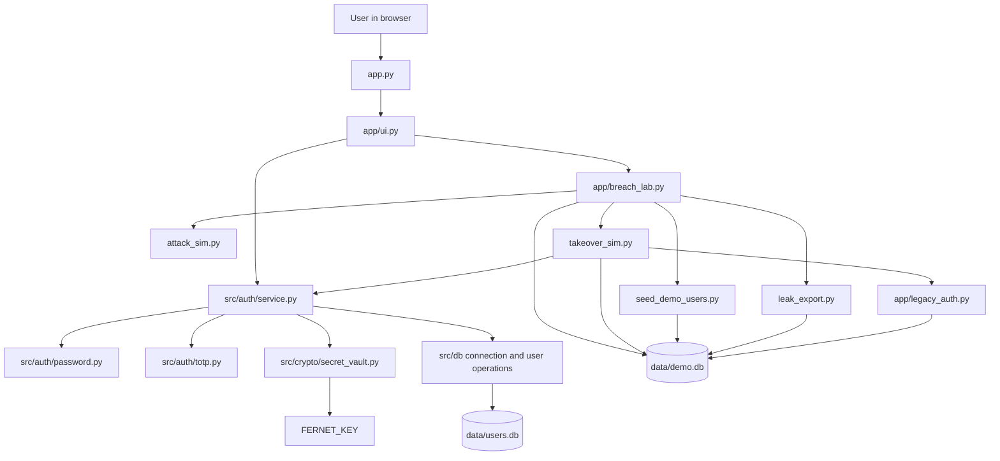

# Secure Authentication System

A Python and Streamlit educational application for exploring password storage, time-based one-time passwords (TOTP), and the difference between legacy and stronger authentication workflows. It includes a normal account flow and a separate, fictional breach lab that uses its own SQLite database.

> **Scope:** This project is intended for local learning and academic demonstration. It is not a production-ready identity or authentication service.

## Table of Contents

- [Project Overview](#project-overview)
- [Problem Statement](#problem-statement)
- [Key Features](#key-features)
- [Security Implementation](#security-implementation)
- [Technology Stack](#technology-stack)
- [Project Architecture](#project-architecture)
- [Project Directory Structure](#project-directory-structure)
- [Installation and Setup](#installation-and-setup)
- [Environment Configuration](#environment-configuration)
- [Running the Application](#running-the-application)
- [Application Usage and Demonstrations](#application-usage-and-demonstrations)
- [Account Takeover Demonstration: Legacy vs Secure](#account-takeover-demonstration-legacy-vs-secure)
- [Testing](#testing)
- [Security Considerations](#security-considerations)
- [Limitations and Future Improvements](#limitations-and-future-improvements)
- [Author and GitHub Profile](#author-and-github-profile)

## Project Overview

The application demonstrates registration and sign-in using password hashing, with optional TOTP-based two-factor authentication. Its Streamlit interface also contains an educational case study and a breach lab for fictional accounts.

The normal account workflow stores users in `data/users.db` by default. The breach lab uses the separate `data/demo.db` database to compare a deliberately weak legacy password store with the project's PBKDF2-based authentication flow. Demo records and credentials are fictional; they are not real leaked accounts.

## Problem Statement

Passwords stored as fast, unsalted hashes can make large-scale guessing and reuse of identical passwords across accounts easier after a database exposure. A password alone also provides no second authentication factor.

This project illustrates these risks with an isolated legacy simulation and contrasts it with unique salts, a deliberately expensive password derivation function, and optional TOTP verification. Its case-study page discusses the 2012 LinkedIn password breach as educational context.

## Key Features

- User registration and sign-in through a Streamlit interface.
- Case-insensitive unique usernames, with registration validation for username and password length and allowed username characters.
- PBKDF2-HMAC-SHA256 password hashing with a fresh random salt per password.
- Optional authenticator-app enrollment using a QR code or a displayed manual setup key.
- TOTP confirmation before two-factor authentication is enabled.
- An account dashboard showing the signed-in user and TOTP status.
- A case-study page with an interactive comparison of unsalted SHA-1 and salted PBKDF2 using a fixed sample string.
- A separate breach lab to seed fictional cohorts, export demo database fields, run a bundled-candidate password simulation, and compare legacy versus secure account takeover attempts.
- Automated tests for backend logic, SQLite operations, Streamlit flows, and demo behavior.

## Security Implementation

- **Password storage:** `src/auth/password.py` uses PBKDF2-HMAC-SHA256 with 600,000 iterations, a random 16-byte salt per password, and a 32-byte derived key. Verification uses `hmac.compare_digest`.
- **TOTP:** Codes are six digits and use 30-second time steps. Verification allows the current step and one step of clock drift in either direction. Successfully accepted steps are recorded so a step cannot be accepted again.
- **TOTP secret storage:** The secret is kept encrypted in SQLite using Fernet. Enrollment is pending until the user confirms a valid code. The Fernet key is read from `FERNET_KEY` in the environment or project `.env` file.
- **Login failures:** The default policy counts failed passwords and invalid or missing TOTP codes, then locks an account for 15 minutes after five such attempts. Replayed TOTP steps are rejected but are not added to the failure count. A successful login clears the failure count and lockout.
- **Database access:** SQL operations use bound parameters. Usernames are unique without regard to case.
- **Unknown users and errors:** Login performs a dummy password check for an unknown username and returns a generic invalid-credentials result for ordinary credential failures.
- **Legacy comparison:** Unsalted SHA-1 is implemented only in the isolated fictional demo store. It is not used by normal registration or login.

## Technology Stack

| Area | Technology |
| --- | --- |
| Language | Python |
| User interface | Streamlit |
| Database | SQLite |
| Password derivation | Python `hashlib` PBKDF2-HMAC-SHA256 |
| TOTP and provisioning URIs | PyOTP |
| TOTP QR codes | `qrcode` |
| TOTP secret encryption | Fernet from `cryptography` |
| Environment variables | `python-dotenv` |
| Tests | Pytest and Streamlit `AppTest` |

Dependency minimum versions are listed in [`requirements.txt`](requirements.txt).

## Project Architecture

The Streamlit interface calls the authentication service rather than implementing authentication itself. The breach lab is a separate UI path and uses the dedicated demo database.



## Project Directory Structure

```text
.
├── app.py
├── app/
│   ├── breach_lab.py
│   ├── demo.py
│   ├── legacy_auth.py
│   ├── session.py
│   ├── theme.py
│   └── ui.py
├── src/
│   ├── auth/
│   │   ├── password.py
│   │   ├── service.py
│   │   └── totp.py
│   ├── crypto/
│   │   └── secret_vault.py
│   └── db/
│       ├── connection.py
│       ├── schema.py
│       └── users.py
├── data/
│   └── .gitkeep
├── tests/
├── attack_sim.py
├── leak_export.py
├── seed_demo_users.py
├── takeover_sim.py
├── wordlist.txt
├── .env.example
├── pytest.ini
├── requirements.txt
└── README.md
```

Database files are created locally and ignored by Git. `data/users.db` is the normal application database; `data/demo.db` is used by the fictional breach lab.

## Installation and Setup

The following commands use Windows PowerShell. Python, `pip`, and Git should be available on your `PATH`.

```powershell
git clone https://github.com/sonal-jakhar/secure-authentication-system.git
Set-Location secure-authentication-system
python -m venv .venv
.\.venv\Scripts\Activate.ps1
python -m pip install --upgrade pip
python -m pip install -r requirements.txt
```

If PowerShell prevents virtual-environment activation due to its execution policy, use an appropriately configured PowerShell session or run the environment's Python executable directly as `.venv\Scripts\python.exe`.

## Environment Configuration

Create a local `.env` from the example if one does not already exist:

```powershell
if (-not (Test-Path .env)) { Copy-Item .env.example .env }
```

Generate a Fernet key:

```powershell
python -c "from src.crypto.secret_vault import generate_fernet_key; print(generate_fernet_key())"
```

Copy the generated value into `.env` as `FERNET_KEY=<generated-value>`. Keep `.env` private and do not commit it. The key is required for TOTP enrollment and for seeding secure demo accounts; basic registration and password-only sign-in do not require it.

| Variable | Behavior |
| --- | --- |
| `FERNET_KEY` | Fernet key used to encrypt TOTP secrets. Required for TOTP operations. |
| `DATABASE_PATH` | Optional SQLite path for the normal user database. Defaults to `data/users.db`; relative paths resolve from the project root. |
| `APP_ENV` | The demo seeder refuses to run when this is set to `production`. |
| `APP_SECRET_KEY` | Present as a placeholder in `.env.example`; it is not currently used by the application. |

The breach lab always uses `data/demo.db`; `DATABASE_PATH` does not redirect that demo database.

## Running the Application

From the activated virtual environment and the project root:

```powershell
streamlit run app.py
```

The application initializes the configured user database at startup. Open the local URL printed by Streamlit, normally `http://localhost:8501`.

## Application Usage and Demonstrations

1. In **Account**, choose **Register** to create a user. Usernames must be 3–64 characters and contain only letters, digits, hyphens, or underscores. Passwords must be 8–256 characters.
2. Sign in with the username and password. Newly registered accounts do not have TOTP enabled.
3. From the dashboard, enter the account password to generate an authenticator QR code. Scan it with an authenticator app, then enter the account password and current six-digit code to confirm enrollment.
4. On subsequent sign-ins, provide the password and authenticator code. The one-time-code field is always shown.
5. Use **Case study** for the historical context and fixed-sample hashing comparison.
6. Use **Breach Lab** for the isolated fictional dataset and its staged demonstrations.

To prepare the breach-lab database from PowerShell, use:

```powershell
python seed_demo_users.py
```

The same action is available in **Breach Lab > Seed Demo Users**. The seeder is intended for local demonstrations, is idempotent for matching demo records, and refuses to run when `APP_ENV=production`.

## Account Takeover Demonstration: Legacy vs Secure

The takeover demonstration uses fictional Cohort A accounts, which are present in both demo stores. Each secure Cohort A account has confirmed TOTP enrollment. Cohort B is seeded in the legacy store only; it is not offered in the takeover page.

1. Seed the demo accounts as described above.
2. In **Breach Lab**, choose **Simulate Database Breach** and export the demo database fields.
3. Choose **Password Attack** and run the legacy and secure simulations. Both use the bundled synthetic candidate list; the secure PBKDF2 simulation has a 30-second time budget and is explicitly not an exhaustive search.
4. Choose **Account Takeover**, select a Cohort A username and **Legacy**, and submit the recovered fictional password.
5. Select **Secure** and submit the same account password with a valid TOTP code. The secure flow calls the normal authentication service and rejects a missing, invalid, or reused code.

For the secure demo, the page can display that account's TOTP QR code to support local testing. Treat this as a lab-only convenience: revealing the QR code reveals the TOTP enrollment secret. If accounts were just seeded, wait for the next 30-second code because the enrollment-confirmation code has already been accepted.

The simulations accept only dumps produced by the project's demo export flow. They are designed to illustrate password-store differences, not to target real accounts or external systems.

## Testing

Install the project dependencies, activate the virtual environment, and run the suite from the project root:

```powershell
python -m pytest -v
```

Pytest discovers tests under `tests/` as configured in `pytest.ini`. Coverage includes password hashing, registration and login, TOTP enrollment and replay checks, account lockout, Fernet encryption, SQLite operations, Streamlit account and breach-lab flows, demo seeding, dump export, password simulations, and takeover behavior. Tests that need a database use temporary SQLite files.

## Security Considerations

- The demo database intentionally contains unsalted SHA-1 password hashes. It is separate from the normal account database and must contain only fictional credentials.
- A password hash is not encryption. A database export can still be attacked offline, and PBKDF2 does not make weak passwords unguessable.
- The Fernet key must be protected separately from the SQLite database. Losing it prevents decryption of stored TOTP secrets; exposing it compromises their confidentiality.
- The breach-lab secure export includes the password hash, salt, username, and encrypted TOTP secret because those are stored fields. It does not include plaintext passwords or the Fernet key.
- Streamlit session state is used for the lab UI and is not a production session manager. The application does not implement a production session model, idle timeout, or CSRF protection.
- Do not use real credentials, real user data, or a production database in the breach lab.

## Limitations and Future Improvements

- The application is a local educational demo, not a hardened public-facing authentication service. Streamlit session-state authentication is not a substitute for production session management.
- The implementation does not provide password reset, account recovery, or TOTP recovery codes.
- Fernet key provisioning and rotation are manual; the project does not include a production secrets-management integration.
- The application uses SQLite and does not include a database migration framework or a production deployment configuration.
- Useful future work could include a hardened web/session layer, recovery workflows, managed key rotation, database migrations, and deployment-specific TLS and operational controls.

## Author and GitHub Profile

**Sonal Jakhar** — [GitHub profile](https://github.com/sonal-jakhar)
