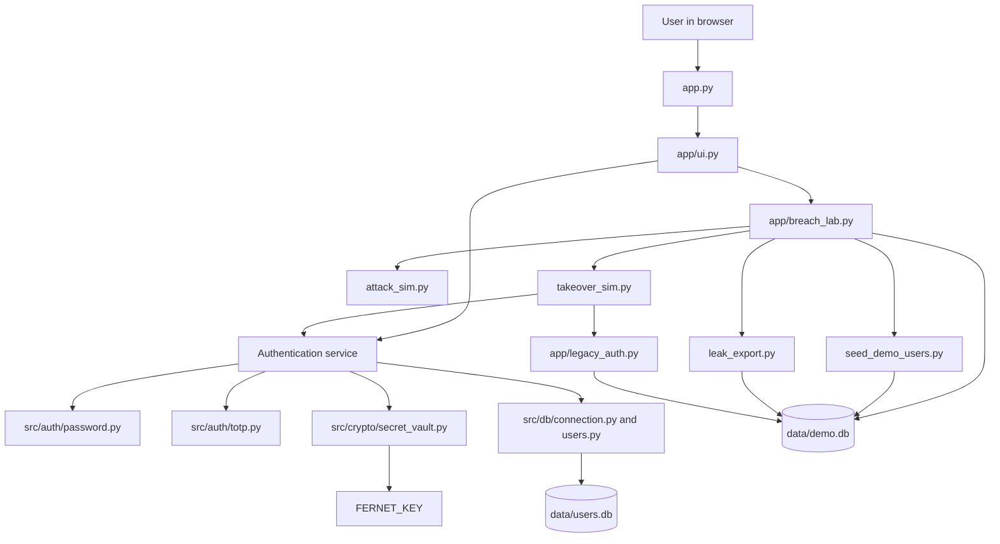

# LinkedIn Password Breach (2012): Authentication Security Case Study

This academic Information and Network Security project implements an authentication-security case study inspired by the **LinkedIn Password Breach (2012)**. It contrasts a deliberately weak, fictional legacy password store with a working authentication flow using salted PBKDF2 password hashes and optional TOTP two-factor authentication.

> **Scope:** This project is an educational implementation inspired by public reporting about the incident. It does not reproduce LinkedIn's internal systems, use actual LinkedIn data, or model the actual breach. All breach-lab accounts and passwords are fictional. This is not a production-ready identity service.

## Table of Contents

1. [Project Overview](#1-project-overview)
2. [LinkedIn Password Breach (2012) – Case Study Background](#2-linkedin-password-breach-2012--case-study-background)
3. [Problem Statement](#3-problem-statement)
4. [Project Objectives](#4-project-objectives)
5. [Case Study Implementation](#5-case-study-implementation-linkedin-password-breach-2012)
6. [Key Features](#6-key-features)
7. [Security Mechanisms](#7-security-mechanisms)
8. [Technology Stack](#8-technology-stack)
9. [System Architecture](#9-system-architecture)
10. [Project Directory Structure](#10-project-directory-structure)
11. [Installation and Setup](#11-installation-and-setup)
12. [Environment Configuration](#12-environment-configuration)
13. [Running the Application](#13-running-the-application)
14. [Application Demonstration](#14-application-demonstration)
15. [Account Takeover Simulation](#15-account-takeover-simulation)
16. [Testing](#16-testing)
17. [Security Considerations](#17-security-considerations)
18. [Limitations and Future Improvements](#18-limitations-and-future-improvements)
19. [References](#19-references)

## 1. Project Overview

The project connects the 2012 LinkedIn password-breach case study to a small, runnable authentication application. A Streamlit interface provides registration, login, optional authenticator-app enrollment, and an educational case-study page. A separate breach lab stages a fictional database export, candidate-password simulation, and account-takeover comparison.

The ordinary account workflow uses `data/users.db` by default. The lab uses `data/demo.db`, keeping its intentionally vulnerable SHA-1 records separate from ordinary user accounts.

## 2. LinkedIn Password Breach (2012) – Case Study Background

In June 2012, LinkedIn confirmed that some member passwords had been compromised after reports that a file containing millions of password hashes had been leaked. Contemporary reporting described the exposed set as approximately 6.5 million hashes and reported the hashes as unsalted SHA-1 values [1, 2].

SHA-1 is a general-purpose hash designed to be fast, not a password-storage function. Without a unique salt, identical passwords produce identical hashes, and an attacker with a copy of the database can test password guesses offline: hash each candidate and compare it with the stolen values. Because SHA-1 is fast, large dictionaries and brute-force candidate sets can be tested at high speed. Weak or reused passwords are especially exposed. If a password is recovered, it could potentially enable access to that account or other services where the same password was reused; this is a risk of credential compromise, not a claim that the 2012 incident caused any particular subsequent takeover.

This project uses the incident as a security case study only. Its legacy store, candidate list, and takeover workflow are synthetic demonstrations and do not contain LinkedIn credentials or reproduce LinkedIn's historical infrastructure.

## 3. Problem Statement

The case study highlights several related authentication risks:

- **Fast password hashing:** A fast general-purpose hash makes each offline password guess inexpensive.
- **No unique salts:** Identical passwords result in identical hashes, and attackers can reuse precomputed lookup results across accounts.
- **Offline guessing:** A stolen hash file can be attacked independently of the live login service using dictionary or brute-force candidates.
- **Password-only access:** If an attacker recovers a password, a password-only login offers no additional factor to stop access.
- **Credential reuse and account takeover:** A recovered password may be tried against the original account or other accounts where it has been reused.

## 4. Project Objectives

The objective is to implement a secure-authentication demonstration inspired by the LinkedIn Password Breach (2012) case study and show a transition from a vulnerable legacy model to improved password storage and authentication.

The proposed model in this project:

- Derives password verifiers using PBKDF2-HMAC-SHA256 with a random 16-byte salt and 600,000 iterations.
- Compares derived password values using constant-time `hmac.compare_digest`.
- Supports RFC 6238-compatible TOTP as an additional factor for accounts that enroll it.
- Encrypts stored TOTP secrets with Fernet.
- Uses the existing authentication service in a fictional account-takeover simulation to show that a known password alone is insufficient for a TOTP-enabled account.

## 5. Case Study Implementation: LinkedIn Password Breach (2012)

The case study consists of two deliberately separated parts. The legacy behavior is a local simulation; the secure account workflow is implemented authentication logic used by the normal application as well as by the secure demo cohort.

### A. Legacy Authentication (Vulnerable Model)

- `app/legacy_auth.py` stores fictional demo passwords as unsalted SHA-1 digests in the `legacy_users` table in `data/demo.db`.
- `attack_sim.py` matches those exported legacy hashes against the bundled synthetic candidate list in `wordlist.txt`. It illustrates offline dictionary guessing; it does not use a real breach corpus or accept arbitrary external database dumps.
- `takeover_sim.py` demonstrates whether a recovered fictional password matches a selected legacy demo account.
- This deliberately weak implementation is isolated from normal registration and login. It is not LinkedIn's source code or a replica of its internal system.

### B. Secure Authentication (Proposed Model)

- Normal registration and login use the implemented PBKDF2-HMAC-SHA256 authentication service with a fresh random salt per password.
- PBKDF2 performs 600,000 iterations per derivation, raising the cost of each offline guess. It does not make weak passwords impossible to guess.
- TOTP enrollment is optional for normal accounts. The secret is encrypted with Fernet, and TOTP is enabled only after password re-verification and a valid enrollment code.
- A TOTP-enabled account requires a valid code at login. Codes are six digits, use 30-second steps, and the verifier accepts a one-step clock-drift window on either side. An accepted time step cannot be reused.
- The secure takeover simulation calls the same login service against the demo database. The seeded Cohort A secure accounts have TOTP enabled, so a compromised password by itself does not complete their login. This protection depends on the TOTP authenticator and its secret remaining secure.
- The secure password-attack simulation tries candidates against exported PBKDF2 hashes for up to 30 seconds by default. It demonstrates increased guessing cost; it is not an exhaustive cracking benchmark or proof that the hashes cannot be recovered.

## 6. Key Features

- Streamlit registration, sign-in, dashboard, and logout flow.
- Username validation (3–64 characters; letters, digits, hyphens, and underscores) and password length validation (8–256 characters).
- Optional TOTP enrollment with a QR code or manual setup key.
- Fernet-encrypted TOTP secret storage and replay-step tracking.
- Account lockout after five failed password or invalid/missing TOTP attempts, for 15 minutes by default.
- Generic invalid-credentials messaging and a dummy password check for unknown usernames.
- An educational case-study page comparing unsalted SHA-1 with salted PBKDF2 using a fixed sample string.
- An isolated breach lab with fictional cohorts, database-field export, candidate-list hash simulation, and legacy-versus-secure takeover attempts.
- Tests covering backend, database, Streamlit, and breach-lab behavior.

## 7. Security Mechanisms

| Mechanism | Implemented behavior |
| --- | --- |
| Password derivation | PBKDF2-HMAC-SHA256, 600,000 iterations, random 16-byte salt, and 32-byte derived key. |
| Password verification | Re-derives the value with the stored salt and iteration count; compares using `hmac.compare_digest`. |
| TOTP | PyOTP TOTP with six digits, a 30-second interval, and acceptance of the current time step plus one adjacent step on either side. |
| TOTP replay control | Persists the most recently accepted time step and rejects a step that is not newer. |
| TOTP secret at rest | Fernet encryption using `FERNET_KEY` from the process environment or project `.env` file. |
| Login failure control | Five failed passwords or invalid/missing TOTP codes trigger a 15-minute lockout by default. Replayed TOTP steps are rejected but do not increment the failure count. |
| SQL operations | User data access uses parameterized SQL statements. |
| Legacy contrast | Unsalted SHA-1 is confined to the separate fictional demo store and is never used by normal authentication. |

The password parameters reflect the implementation and are not claims that PBKDF2 is the only or universally preferred password-storage choice. See the NIST and OWASP guidance in [References](#19-references).

## 8. Technology Stack

| Area | Technology |
| --- | --- |
| Language | Python |
| User interface | Streamlit |
| Database | SQLite |
| Password derivation | Python standard-library `hashlib.pbkdf2_hmac` |
| TOTP and provisioning URI | PyOTP |
| QR generation | `qrcode` |
| TOTP secret encryption | Fernet from `cryptography` |
| Environment configuration | `python-dotenv` |
| Tests | Pytest and Streamlit `AppTest` |

Dependency minimum versions are in [`requirements.txt`](requirements.txt).

## 9. System Architecture

The account interface delegates authentication decisions to `src/auth/service.py`. The breach lab uses a separate demo database and calls the service for secure demo login; legacy verification stays in its own module.



## 10. Project Directory Structure

```text
.
├── app.py
├── app/
│   ├── breach_lab.py
│   ├── demo.py
│   ├── legacy_auth.py
│   ├── session.py
│   ├── theme.py
│   └── ui.py
├── src/
│   ├── auth/
│   │   ├── password.py
│   │   ├── service.py
│   │   └── totp.py
│   ├── crypto/
│   │   └── secret_vault.py
│   └── db/
│       ├── connection.py
│       ├── schema.py
│       └── users.py
├── tests/
│   ├── conftest.py
│   ├── test_attack_sim.py
│   ├── test_auth.py
│   ├── test_breach_lab_ui.py
│   ├── test_database.py
│   ├── test_demo.py
│   ├── test_leak_export.py
│   ├── test_legacy_auth.py
│   ├── test_password.py
│   ├── test_secret_vault.py
│   ├── test_seed_demo_users.py
│   ├── test_session.py
│   ├── test_takeover_sim.py
│   ├── test_totp.py
│   └── test_ui.py
├── data/                 # Local SQLite databases; ignored by Git
├── .streamlit/
│   └── config.toml
├── attack_sim.py
├── leak_export.py
├── seed_demo_users.py
├── takeover_sim.py
├── wordlist.txt
├── .env.example
├── .gitignore
├── pytest.ini
├── requirements.txt
└── README.md
```

`data/users.db` is the normal account database. The legacy and secure demo tables are in the separate `data/demo.db`.

## 11. Installation and Setup

These commands use Windows PowerShell. Python, Git, and `pip` must be available on `PATH`.

```powershell
git clone https://github.com/sonal-jakhar/secure-authentication-system.git
Set-Location secure-authentication-system
python -m venv .venv
.\.venv\Scripts\Activate.ps1
python -m pip install --upgrade pip
python -m pip install -r requirements.txt
```

If PowerShell blocks activation due to its execution policy, use an appropriately configured PowerShell session or call the virtual environment's interpreter directly as `.venv\Scripts\python.exe`.

## 12. Environment Configuration

Create `.env` from `.env.example` if it does not already exist:

```powershell
if (-not (Test-Path .env)) { Copy-Item .env.example .env }
```

Generate a Fernet key:

```powershell
python -c "from src.crypto.secret_vault import generate_fernet_key; print(generate_fernet_key())"
```

Set the generated value in `.env` as `FERNET_KEY=<generated-value>`. Keep `.env` private and do not commit it.

| Variable | Behavior |
| --- | --- |
| `FERNET_KEY` | Fernet key required for TOTP secret encryption/decryption and secure demo seeding. |
| `DATABASE_PATH` | Optional normal-account SQLite path; defaults to `data/users.db`. Relative paths resolve from the project root. |
| `APP_ENV` | The demo seeder refuses to run when this is set to `production`. |
| `APP_SECRET_KEY` | An unused placeholder in `.env.example`; it currently has no effect on the application. |

Basic registration and password-only login do not require a Fernet key. TOTP enrollment does. The breach lab always uses `data/demo.db`; `DATABASE_PATH` does not redirect it.

## 13. Running the Application

From the activated environment and project root:

```powershell
streamlit run app.py
```

The app initializes the configured user database at startup. Open the local URL printed by Streamlit, normally `http://localhost:8501`.

To prepare the fictional breach-lab accounts from a separate PowerShell session, with the environment activated and `.env` configured:

```powershell
python seed_demo_users.py
```

The same seeding action is available in **Breach Lab > Seed Demo Users**. The seeder is idempotent for matching records and refuses to run when `APP_ENV=production`.

## 14. Application Demonstration

1. Select **Account > Register**, create a username and password, then sign in.
2. The dashboard displays account status and whether TOTP is enabled.
3. To enable TOTP, re-enter the account password, scan the displayed QR code (or enter the manual key in an authenticator app), then confirm with the password and a valid six-digit code.
4. TOTP-enabled accounts require a code at future sign-ins. For accounts without TOTP, password-only sign-in remains available.
5. Open **Case study** for educational background and the fixed-sample comparison of unsalted SHA-1 with randomly salted PBKDF2.
6. Open **Breach Lab** to seed fictional users, export their stored password fields, run candidate-list simulations, or test a takeover scenario.

## 15. Account Takeover Simulation

The takeover page uses fictional Cohort A accounts seeded into both the legacy and secure tables. Each secure Cohort A account has confirmed TOTP. Cohort B is legacy-only and is not offered for takeover.

1. Seed the demo accounts.
2. In **Breach Lab > Simulate Database Breach**, export the demo database fields.
3. In **Breach Lab > Password Attack**, run the legacy and secure simulations against the exported dumps. The attacks use only the bundled synthetic candidate list. The secure PBKDF2 attack stops after a 30-second budget by default and is not exhaustive.
4. In **Breach Lab > Account Takeover**, select a Cohort A username and **Legacy**, then test its recovered fictional password.
5. Select **Secure** and submit the same account password with a current TOTP code. The secure option calls the normal authentication service; a missing, invalid, or reused code is rejected.

The page can display the selected secure demo account's TOTP QR code for local testing. This is a lab-only convenience that reveals the enrollment secret. After seeding, wait for the next 30-second time step because the enrollment-confirmation code has already been accepted.

The export and attack code operate on the app's local demo dump types; they do not accept real breach files or connect to external systems. The comparison illustrates that TOTP adds a second requirement to a TOTP-enabled account. It does not prevent takeover if both the password and TOTP factor are compromised.

## 16. Testing

Run the test suite from the project root with the dependencies installed:

```powershell
python -m pytest -v
```

`pytest.ini` configures `tests/` as the test directory. Tests cover password hashing, registration and login, TOTP verification and replay control, lockout, Fernet encryption, SQLite operations, Streamlit account and breach-lab flows, demo seeding, breach export, password attacks, and takeover behavior. Tests that need a database use temporary SQLite files.

## 17. Security Considerations

- Never place real user data, real credentials, or actual breach data in the demo database. The legacy SHA-1 implementation is intentionally insecure and for fictional demonstration only.
- Hashes are not encrypted passwords. If a stored verifier is exposed, weak passwords may still be guessed offline. PBKDF2 slows guesses but does not make them impossible.
- Protect `FERNET_KEY` independently from the database. Loss of the key makes stored TOTP secrets unreadable; disclosure weakens their confidentiality.
- TOTP is optional for ordinary accounts. Only enrolled accounts require it at sign-in; the seeded secure Cohort A accounts are enrolled for the simulation.
- The secure demo can reveal the TOTP provisioning QR code. Do not treat this feature as safe for real accounts.
- The app uses Streamlit session state for its UI and does not provide production session management, idle expiration, or CSRF protection.
- Account lockout can affect legitimate users and is a basic demonstration control, not a complete abuse-prevention system.

## 18. Limitations and Future Improvements

- The project is a local academic demonstration, not a hardened public authentication service.
- TOTP enrollment is supported, but password recovery, account recovery, and TOTP recovery codes are not implemented.
- Fernet key provisioning and rotation are manual; no managed secrets service or key-rotation workflow is provided.
- SQLite is used without a migration framework or production deployment configuration.
- Streamlit session-state authentication is not a production session model.
- Future work could add recovery workflows, a hardened session and deployment layer, managed key lifecycle, database migrations, and operational security controls.

## 19. References

1. BBC News, [LinkedIn passwords leaked by hackers](https://www.bbc.com/news/technology-18338956), 6 June 2012. Contemporary reporting on LinkedIn's confirmation that member passwords had been compromised.
2. Ars Technica, [6.5 million LinkedIn passwords stolen in hack](https://arstechnica.com/information-technology/2012/06/6-5-million-linkedin-passwords-stolen-in-hack/), June 2012. Contemporary coverage of the exposed password-hash set and its SHA-1 storage.
3. NIST, [SP 800-63B-4: Digital Identity Guidelines — Authentication and Authenticator Management](https://pages.nist.gov/800-63-4/sp800-63b.html), 2025. Current NIST guidance for authentication and password verifiers.
4. K. Moriarty et al., IETF, [RFC 8018: PKCS #5 v2.1 — Password-Based Cryptography Specification](https://www.rfc-editor.org/rfc/rfc8018.html), 2017. Specifies PBKDF2 and related password-based cryptography.
5. D. M'Raihi et al., IETF, [RFC 6238: TOTP — Time-Based One-Time Password Algorithm](https://www.rfc-editor.org/rfc/rfc6238.html), 2011.
6. OWASP, [Password Storage Cheat Sheet](https://cheatsheetseries.owasp.org/cheatsheets/Password_Storage_Cheat_Sheet.html). Guidance on password hashing, salts, and work factors.

